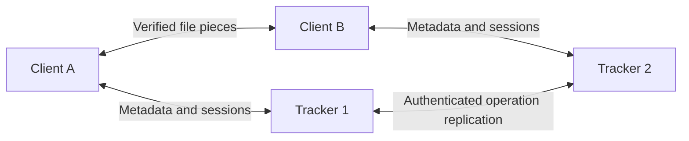

# Peer-to-Peer Distributed File Sharing

A C++17 file-sharing system with two metadata trackers and direct peer transfers. Users create groups, approve membership requests, and share files in 512 KiB pieces. Downloads verify each piece and the complete file with SHA1, retry other peers on corruption or connection failure, and automatically register completed files as seeders.

## Features

- **Parallel transfers:** download pieces from multiple peers and run up to four file downloads concurrently.
- **Verified content:** validate every 512 KiB piece and the complete file with SHA1; retry alternate peers on corruption or connection failure.
- **Group-based sharing:** manage membership requests, owner permissions, and independent shares across groups.
- **Two-tracker availability:** preserve sessions across failover and reconcile durable operation logs after disconnection.
- **Authenticated communication:** signed sessions, metadata responses, and download tickets; authenticated tracker replication.
- **Safe file publication:** verify temporary downloads before creating the destination, preserving existing files.
- **Interactive progress:** keep the command prompt responsive and retain completed-download history across restarts.

## Architecture

Trackers coordinate authentication, groups, file metadata, and peer discovery. File contents travel directly between clients; each client acts as both a downloader and a seeder.



Ordered maps index users, groups, sessions, and file registrations. Sets maintain unique memberships and seeders. Download workers select pieces through an atomic counter, distribute requests across peers, and write verified data at its file offset. Mutexes protect shared state, and fixed worker pools bound connection handling.

See the [technical report](docs/TECHNICAL_REPORT.md) for protocol formats, data structures, algorithms, and design trade-offs.

## Build

Dependencies: a C++17 compiler, POSIX sockets, threads, Make, and OpenSSL development headers/libcrypto. Python 3.9+ is needed only for the tests. Networking and storage use POSIX system calls; cryptographic operations use OpenSSL.

On macOS, install OpenSSL if needed:

```sh
brew install openssl@3 pkg-config
make
```

On Debian/Ubuntu:

```sh
sudo apt-get install g++ make libssl-dev pkg-config python3
make CXX=g++
```

Individual directories also support `make`. OpenSSL paths come from `pkg-config`, Homebrew if available, or the compiler's system defaults. `CPPFLAGS` and `LDFLAGS` can be supplied for another installation.

## Run

Each tracker configuration contains exactly two different IPv4 endpoints in a fixed order:

```text
127.0.0.1:5001
127.0.0.1:6001
```

Start the trackers in two terminals:

```sh
cd tracker
./tracker tracker_info.txt 1
```

```sh
cd tracker
./tracker tracker_info.txt 2
```

Type `quit` in a tracker terminal to stop it. Journals are retained on normal shutdown and crashes. Each tracker writes its own `tracker_state_1.log` or `tracker_state_2.log` in its working directory. Trackers can run in separate working directories or on separate hosts.

The first tracker startup creates a private, 32-byte cluster signing seed at `tracker_info.txt.key`. Both trackers must use **the same seed**. The default works when they use the same configuration file on one machine. For different hosts, securely copy that seed to the second host with permissions `0600`, or supply a common key explicitly:

```sh
./tracker /absolute/path/tracker_info.txt 2 /private/path/cluster.key
```

The ordered endpoint configuration must agree on both hosts. Keep the seed and tracker journals private; never commit them. The key authenticates replication and signs sessions, metadata responses, and group-scoped download tickets. Clients receive only the public key and pin it on first connection in their working directory. After intentional key replacement, inspect the configuration before removing the corresponding `.p2p-public-key-*` pin.

Start a client in another terminal:

```sh
cd client
./client 127.0.0.1:7000 tracker_info.txt
```

Use a different listening port for every client. Startup validates that the listening address is available. Client and tracker configurations can be different files as long as their endpoint lists agree. Clients do not need the private cluster seed.

## Commands

| Command | Behavior |
| --- | --- |
| `create_user <uid> <password>` | Create an account; passwords are stored using salted PBKDF2-SHA256 |
| `login <uid> <password>` | Start a signed session; a live duplicate login is rejected |
| `logout` | Revoke the session, cancel its downloads, and stop its shares |
| `create_group <gid>` | Create a group and become its owner |
| `join_group <gid>` | Submit one pending request |
| `leave_group <gid>` | Leave and stop this user's shares in that group |
| `list_groups` | List groups |
| `list_requests <gid>` | Show pending requests, owner only |
| `accept_request <gid> <uid>` | Accept a request, owner only |
| `upload_file <gid> <path>` | Hash and register a local file; file bytes remain on the client |
| `list_files <gid>` | List files with online seeders, members only |
| `download_file <gid> <filename> <destination>` | Start a background download to a filename or directory |
| `show_downloads` | Show `[D] [gid] name percent%`, `[C] [gid] name`, or `[F] [gid] name reason` |
| `stop_share <gid> <filename>` | Stop only this session's share in this group |
| `quit` | Gracefully stop the client and attempt logout |

Two-word aliases, such as `create user` and `show downloads`, are also accepted. Quote arguments containing spaces. User/group IDs are 1–64 ASCII letters, digits, dots, hyphens, or underscores. Filenames can include spaces and colons. Files from 0 bytes through 1 GiB are supported. Passwords contain 1–256 bytes.

An existing destination is never overwritten. Pieces go to a private temporary file beside the destination; the final path is published only after all hashes match. An error removes the temporary file. Renaming a download locally preserves its original network filename and content identity. Sharing the same basename in different groups is supported; a conflicting file with that name within the same group is rejected while registered seeders remain.

If the owner leaves, ownership passes to the lexicographically first remaining member. A group with no remaining members is deleted. Completed-download history persists in `.p2p-downloads-<IP>-<PORT>` in the client's working directory, scoped to the user. Shares and unfinished downloads are not restored after process restart.

### Example

Alice:

```text
create_user alice password
login alice password
create_group study
upload_file study "/absolute/path/my notes.pdf"
```

Bob, in another client:

```text
create_user bob password
login bob password
join_group study
```

Alice:

```text
list_requests study
accept_request study bob
```

Bob:

```text
list_files study
download_file study "my notes.pdf" "/absolute/path/downloaded notes.pdf"
show_downloads
```

The prompt remains available while the download runs. Bob becomes a seeder for `my notes.pdf` after verification, even though his local copy has a different basename.

## Tracker consistency and failures

When trackers can communicate, tracker 2 forwards client operations to tracker 1. Mutations are appended and `fsync`ed locally, and synchronization is attempted before the response. Requests have stable IDs and keyed fingerprints so retrying the same mutation returns its original response; reusing the ID with different arguments is rejected.

When the other tracker is unreachable, either tracker continues using its local journal. Replication exchanges immutable operations with per-origin sequence numbers and Lamport clocks. A returning tracker merges missing operations before listening, and the background exchange retries every 500 ms. Independent writes made on both sides of a partition survive reconciliation.

**Partition semantics are eventual consistency.** Each tracker accepts requests against its local state while disconnected. After reconnect, both replay the same operation order and resolve conflicting account, group, or session changes deterministically. Independent updates survive reconciliation. Writes acknowledged during disconnection remain durable on the accepting node and become visible on its peer after synchronization; global exclusivity is not guaranteed while both nodes accept isolated writes.

Sessions last up to 12 hours and can be used after tracker failover. Clients renew 20-second liveness leases every four seconds. A crashed client can remain listed until its lease expires; download workers try another peer after a bounded deadline. Logout removes its registrations immediately. Peer requests require a signed ticket and a current tracker authorization check, including membership, requester session, and seeder registration.

## Protocol and resource limits

All links use TCP and a four-byte network-order payload length followed by a length-prefixed field vector. Reads and writes loop over partial transmissions. Client RPC replies are signed and bound to their request ID. Replica exchanges use HMAC-SHA256, timestamps, and replay-checked nonces.

Limits include a 1 MiB message cap, 512 KiB piece cap, 2.5-second complete-frame deadline, 800 ms connect deadline, eight server workers with a 64-socket queue, four active download jobs, and eight concurrent piece requests across those jobs. A client retains up to 1000 job/history entries. Trackers cap live leases at 4096, mutation records at 100,000, and journals at 128 MiB; the journal has no compactor yet. Capacity limits return explicit errors.

## Tests

```sh
make test
P2P_LARGE_TEST=1 python3 tests/integration.py Integration.test_one_gib_transfer
```

The tests create isolated temporary directories and loopback listeners; they do not use real accounts or external servers. They test independent tracker storage, recovery, concurrent and partitioned writes, sessions, group permissions, piece boundaries, corrupted/disconnected/stalled peers, simultaneous file downloads, fragmented and forged responses, malformed input, final hash failure, persistent history, and safe destination handling.

Sanitizer builds require a clean rebuild:

```sh
make clean
ASAN_OPTIONS=detect_leaks=0:halt_on_error=1 make SANITIZE=address test
make clean
TSAN_OPTIONS=halt_on_error=1 make SANITIZE=thread test
```

The address-sanitizer command above disables leak detection for Apple Silicon, where LeakSanitizer is unavailable. Use `detect_leaks=1` on supported platforms. The Linux CI workflow includes GCC builds, integration tests, and sanitizer checks.

Local validation covers all 23 behavioral cases, including a separate 1 GiB transfer with independently matching hashes. The 22 smaller cases also pass AddressSanitizer, UndefinedBehaviorSanitizer, and ThreadSanitizer checks. See [test results](docs/VALIDATION.md) for the environment and execution details, or follow the [testing guide](docs/TESTING_GUIDE.md) for individual scenarios and a three-client demonstration.

## Scope and limitations

- **Network model:** two IPv4 trackers and directly reachable peers; NAT traversal is outside the implementation.
- **Consistency:** deterministic eventual consistency during partitions, with a preferred writer while trackers can communicate.
- **Confidentiality:** signatures authenticate traffic, but transport is not encrypted. Use a trusted network or encrypted tunnel for sensitive data.
- **Integrity:** SHA1 provides the piece and file verification required by the AOS specification.
- **Persistence:** tracker journals and completed-download history survive restarts. Active shares must be registered again, and interrupted downloads start over.
- **Storage lifecycle:** journals have an explicit size limit and currently require administrative retention management; automatic compaction is not implemented.

Keep tracker identities, ordered endpoint configurations, and the shared signing seed consistent across restarts. Preserve the journals to retain users, groups, and file metadata.

Developed for AOS Assignment 3, IIIT Hyderabad, Monsoon 2025.
