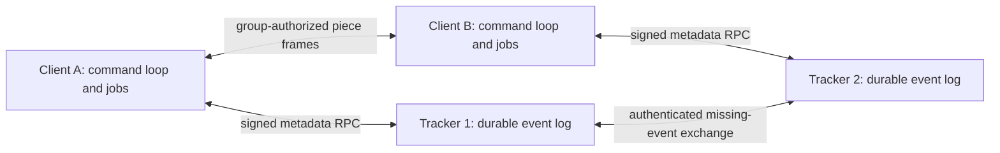

# Implementation and protocol report

This report describes the repaired Assignment 3 implementation. The original PDF is archived separately; its qualitative predictions are not benchmarks. Concrete execution results belong in [validation](VALIDATION.md).

## Architecture and responsibilities

`common/common.hpp` contains bounded field encoding, transport deadlines, descriptor ownership, the fixed-worker server, address/input validation, OpenSSL cryptographic helpers, metadata validation, and streaming hashing. `tracker/tracker.cpp` implements journal recovery, replicated event reconciliation, sessions/leases, and command authorization. `client/client.cpp` implements the interactive command loop, background jobs, peer serving, verified piece scheduling, local sharing, and completed-download history.



File bytes are stored only at peers. Trackers store users, groups, membership requests, file size/content and piece hashes, and seeder registrations. Client-to-client requests remain direct transfers; tracker authorization carries metadata, not file contents.

## Data structures and ownership

- Ordered maps hold users, groups, sessions, share registrations, request responses, and liveness leases. They provide predictable lookup and stable iteration.
- Group member/request sets enforce uniqueness and deterministic owner transfer.
- Each tracker has two event vectors, one for each origin, with contiguous sequence numbers. An event has an origin, sequence, Lamport clock, random request ID, keyed request fingerprint, action, response, and authentication tag.
- Shared files are identified by group and original filename, with canonical file-size, whole-file hash, and piece-hash metadata. The seeder set contains stable session IDs, not connection descriptors. Conflicting metadata is not combined into one peer list.
- Client local shares are indexed by `(group, original filename)` and hold the real path and metadata. A local destination basename is never substituted for the original identity.
- A job owns its cancellation flag, progress counter, immutable metadata after initialization, error/completion state, and joinable thread. A per-file worker group shares an atomic next-piece counter.
- RAII descriptors own files and sockets; server queues transfer descriptor ownership to fixed workers. Threads are joined at shutdown. No detached connection handlers or shared tracker receive socket remain.

Tracker derived state is protected by one mutex, replication scheduling by another, and replay nonces by another. Journal writes and derived-state transitions occur under the state mutex. Network exchanges occur after releasing it. Client session/shares/history/job-list state has its own mutex; job presentation fields have a job mutex. Atomics carry progress, cancellation, termination, and completion notifications.

## Replication, recovery, and partitions

While connected, tracker 2 forwards client RPCs to tracker 1 using the authenticated replica role. This normally serializes mutations through one writer and makes connected duplicate-login/group-name decisions consistent. A mutation first appends an authenticated record and `fsync`s its local journal, then attempts a complete missing-event exchange before replying. Repeated requests return the cached result, but only if a keyed fingerprint matches the exact original arguments and bearer token.

Each origin assigns a monotonically increasing sequence and a Lamport clock greater than every clock it has observed. Synchronization exchanges per-origin counts, bounded batches of missing events, and current leases. Receivers verify authentication, sequence continuity, and duplicate identity before appending. They never clear state to accept a remote snapshot. Batched exchanges continue until both cursors agree, or a bounded network operation fails. Background synchronization retries every 500 ms. A returning node reconciles with the reachable peer before exposing its listener.

Derived state is reconstructed by sorting the union by `(Lamport clock, origin number, sequence)` and applying each unique request once. Operations retain semantic preconditions during replay. Independent changes survive regardless of reconnection order. For conflicting creates, the first valid creation in that order wins. Session logins later in the order supersede earlier sessions. Group deletion/leave and share changes follow that same deterministic state machine.

During a partition, either node accepts operations against its local view to meet the one-surviving-tracker availability requirement. **This gives eventual consistency after recovery, not globally serialized decisions during a partition.** Concurrent conflicting operations can have different provisional local outcomes. Retaining all operations prevents stale-snapshot erasure; deterministic replay resolves conflicts once communication returns. Choosing availability on both isolated nodes cannot also enforce instantaneous global exclusivity. Do not describe this as a consensus or linearizable database.

Journals are independent, private files and are never deleted at shutdown. A file lock rejects concurrent use of the same journal. Startup validates complete records, rejects corruption/authentication failures, and truncates only an incomplete final record left by an interrupted append. Recovery does not depend on a shared filesystem or a stale `.lock` marker. The operation history is currently retained without compaction, with explicit storage/event caps.

## Authentication and permissions

The two trackers share a private 32-byte seed stored with mode `0600`. HMAC-SHA256 authenticates replica requests, responses, immutable events, and request fingerprints. Timestamps plus bounded replay-nonce storage reject unauthenticated/replayed replica messages. Client commands cannot enter the replica role without the key.

The seed also supplies an Ed25519 signing key. Clients receive and pin its public key. Session tokens bind a user, session ID, listening endpoint, and expiration. Client RPC responses are signed and bind the original request ID. A client retries with the same ID after a connection failure and verifies replies before parsing command-specific data. Sessions are independent of TCP descriptors, so reconnecting through the other tracker preserves authentication once the session operation has replicated.

A 20-second liveness lease is renewed every four seconds. Seeder discovery uses replicated sessions and leases. A normal logout revokes the session and removes its registrations; the client clears local shares and cancels jobs after acknowledgement. A crashed client is eventually filtered by lease expiry. A new login is allowed after the old lease expires and supersedes the previous session. Isolated simultaneous logins resolve by event order on reconciliation.

Download metadata includes a signed ticket binding requester, session, group, original filename, content hash, byte count, and expiration. The peer checks the signature and local share identity, then asks a tracker to authorize the piece against current membership, requester session, and seeder registration. Leaving a group, logging out, or stopping a share invalidates subsequent piece requests even when a ticket was issued earlier. A piece already authorized and in flight can finish; future authorization observes the revocation after the relevant operation has reached that tracker. Metadata has the same eventual-consistency limits as replication during a partition.

Passwords use a fresh random salt and PBKDF2-SHA256 with 100,000 iterations. They are not stored or logged as plaintext. The transport is not encrypted: authentication prevents forged responses/replication, while confidentiality still requires a trusted network or external encrypted tunnel. Public-key pinning on first use assumes that initial connection is trusted.

## Piece selection, integrity, and output publication

The uploader reads a regular file in 512 KiB buffers, computes piece SHA1 and complete-file SHA1 in one pass, and compares file size plus modification/change timestamps before and after hashing. Files may be empty or as large as 1 GiB. Tracker metadata validation checks exact piece count, hash format, size bounds, and field arity.

Each file has up to four workers. They claim distinct piece indices from an atomic counter. The first candidate peer is `piece_index mod peer_count`; subsequent candidates rotate through the remaining peers. Corrupt, short, disconnected, or unresponsive responses are rejected. The worker immediately tries a different peer, and permits a second bounded round if necessary. A global semaphore limits a client's active piece requests to eight across at most four file jobs.

Peers return one bounded framed piece. The downloader checks its exact expected size and SHA1 before `pwrite` to the piece offset. Successful workers update atomic progress. The command loop remains free to display status or start another file. Each tracker operation owns its TCP connection, eliminating mixed replies between jobs, heartbeat, and the command loop.

Downloads use a mode-0600 temporary file in the destination directory. After all pieces complete, the client syncs the file and independently hashes the assembled content. Only a correct file is published. `link` creates the final path only if it does not already exist, so neither an existing destination nor one created during the transfer is overwritten. Errors/cancellation remove the temporary path and produce a failed job status. Output paths can name a directory or a specific filename.

Completed history is written atomically and scoped to user, group, original filename, destination, hash, and size. It is loaded on restart, with basic file-existence/size checking for display. It records completion verified at download time; later local tampering is not continuously rehashed. New sharing always verifies pieces when serving. Shares and unfinished downloads are not automatically resumed after restart.

## Wire format

All integers below are unsigned, 32-bit, network byte order. A frame is:

```text
payload_length | payload
payload := field_count | (field_length | field_bytes) repeated field_count times
```

Length-prefixed fields can contain spaces, colons, zero bytes, and nested vectors. Payloads are limited to 1 MiB before allocation. Parsers require every declared field to fit and consume the complete payload. Transport helpers loop across partial reads/writes and `EINTR`/`EAGAIN`, using a steady-clock deadline for the entire frame rather than resetting it after every byte. SIGPIPE is ignored; broken sockets become errors.

Representative payload fields:

```text
HELLO
  -> OK, P2P/2, public_key

RPC, request_id, session_token, command, packed_arguments
  -> SIGNED, request_id, packed_result, signature(request_id + packed_result)

result := OK|ERROR, readable_status, optional_result_fields...

REPLICA, timestamp, nonce, packed_body, HMAC(envelope)
  -> nonce, packed_result, HMAC(nonce + packed_result)

replica_body := SYNC, per_origin_counts, packed_event_batch, packed_leases
             | FORWARD, packed_client_RPC

GET, signed_ticket, group_id, content_hash, piece_index
  -> OK, binary_piece
   | ERROR, readable_reason
```

The `+` notation above means packing the indicated fields with the same length encoding, not unescaped string concatenation. Metadata is a nested vector of size, full-file SHA1, and a nested hash list. Download results additionally contain a nested peer list and signed ticket. Multiple complete tracker frames can share a TCP connection without merging identities; each RPC carries its own token and request ID. Peer transfer connections carry one piece request.

## Error and resource policy

Connect attempts have an 800 ms deadline; complete-frame sends and receives have a 2.5-second deadline. Each server has eight workers and a 64-connection queue. Overflow connections close without creating another thread. Malformed ports, counts, signatures, and oversized messages return errors instead of unchecked conversions or allocations. Local file/socket descriptors close through RAII. File I/O handles short writes and interruptions; directory sync follows journal creation and atomic publication.

Client limits include four active jobs, eight active piece requests, and 1000 job/history entries. Tracker limits include 4096 live leases, 100,000 mutation events, and 128 MiB of journal data. Capacity and I/O errors are explicit. The log needs an administrative compaction/checkpoint design for long-lived production use; it is not silently truncated to make space.

## Challenges resolved and remaining scope

The original protocol treated a short TCP read as message completion. Explicit framing and signed envelopes now separate transport completeness from operation status. The original failover depended on socket-local authentication; signed, replicated sessions now survive connection changes. The original snapshot mechanism erased updates during stale recovery; append-only authenticated operation merging now preserves independent history. The original synchronous file call prevented real multi-file concurrency; managed jobs and independent RPC connections now keep the CLI responsive.

The implementation intentionally retains SHA1 to meet the specification, uses OpenSSL for cryptographic primitives, and uses POSIX facilities for networking/storage. Course-specific permission for crypto dependencies remains a grading-policy question. No NAT traversal, resumable partial downloads, transport encryption, automatic journal compaction, or global consensus during partitions is claimed.

## References

- AOS Assignment 3, Monsoon 2025, IIIT Hyderabad: the local assignment PDF supplied with the review.
- OpenSSL public EVP, HMAC, PBKDF2, and Ed25519 interfaces, as declared in the installed OpenSSL headers used for compilation.
- POSIX socket, `poll`, file-descriptor, `pread`/`pwrite`, `fsync`, and atomic file-publication interfaces.
- [GitHub checkout action](https://github.com/actions/checkout) and [Python setup action](https://github.com/actions/setup-python), used by the configured Linux validation workflow.
